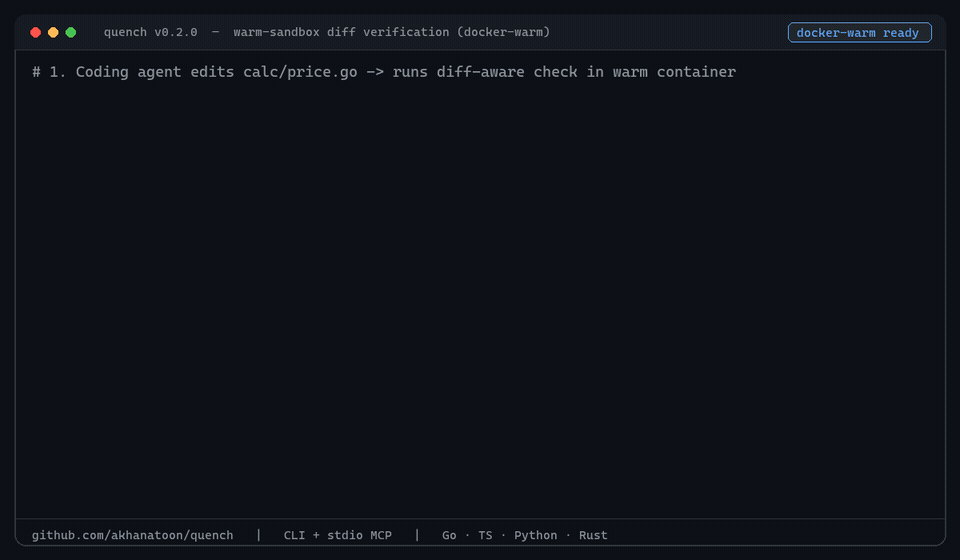

# `quench` 🔥💧

**Warm-sandbox, diff-aware verification for AI coding agents — in ~1 second, not CI minutes.**

[](https://github.com/akhanatoon/quench/actions/workflows/ci.yml)
[](LICENSE)

`quench` is a single-binary Go CLI and native `stdio` MCP server that verifies only what changed in `git diff` (plus direct reverse-importers) inside a persistent warm Docker container or locally, returning a compressed, token-lean JSON report coding agents can fix in a single turn.

<p align="center">
  
</p>

---

## Why `quench`?

Coding agents waste **minutes** and **thousands of context tokens** running full test suites or cold container builds on every edit:

| Workflow | Cold Setup | Scope | Measured Latency | Agent Output Cost |
| :--- | :--- | :--- | :--- | :--- |
| **Classic CI Push Loop** | Full image + dep install | Entire repository | `2m – 8m` | Manual log scraping |
| **Raw `go test` / `pytest` in shell** | Host state drift | Entire test suite | `8s – 45s` | `2,000 – 15,000` tokens of noisy stdout |
| **`quench` (Warm Sandbox + Diff-Aware)** | **0ms** (warm + cached volume) | **Changed targets + direct importers** | **`~1.09s`** *(Go warm container)* | **`~120 – 400` tokens** (failures only) |

### Key Capabilities

1. **Diff-Aware + Reverse-Importer Graph** — Inspects staged, unstaged, untracked, and `--base <ref>` changes; resolves affected Go packages **plus 1-hop direct Go importers** via stdlib `go/parser`, Vitest/Jest/ESLint files, Rust `cargo` crates, and mapped/reverse-imported Python `pytest` modules. Automatically escalates to a full-suite run when critical manifests (`go.mod`, `package.json`, `tsconfig.json`, `pyproject.toml`, `Cargo.toml`) change.
2. **Polyglot & Monorepo Zero-Config** — Detects root and nested workspaces (`apps/*`, `services/*`, `packages/*`, `backend/`, `frontend/`, `web/`, `api/`, `src-tauri/`) across **Go, Node/TypeScript, Python, and Rust** with per-check `working_dir` isolation.
3. **Warm Docker Sandbox + Lockfile Hash Sync** — Keeps a per-repo background container (`quench-warm-<hash8>`) alive with named dependency cache volumes (`/go/pkg/mod`, `node_modules`, `pip`, `cargo/registry`). Hashes lockfiles so dependency installs run **only** when lockfiles actually change, and supports post-sync `network: none` isolation.
4. **Token-Lean Output Contract + Compression Stats** — Swallows passing test noise, strips ANSI codes, deduplicates diagnostics, caps output at 10 unique failures (`file`, `line`, `symbol`, `message`, `suggested_scope`, `raw_excerpt`), and reports exact `output_stats` (`raw_bytes`, `report_bytes`, `reduction_pct`).
5. **One-Command MCP Onboarding** — Native `stdio` MCP server (`quench mcp`) with `quench mcp install --client claude|codex|cursor|opencode` and `quench doctor`.

---

## Installation

### One-Line Installer (Linux / macOS)

```bash
curl -fsSL https://raw.githubusercontent.com/akhanatoon/quench/main/scripts/install.sh | sh
```

### One-Line Installer (Windows PowerShell)

```powershell
irm https://raw.githubusercontent.com/akhanatoon/quench/main/scripts/install.ps1 | iex
```

### Go Install

```bash
go install github.com/akhanatoon/quench/cmd/quench@latest
```

### Prebuilt Binaries

Download single static binaries for **Linux**, **macOS** (`amd64` / `arm64`), and **Windows** from [GitHub Releases](https://github.com/akhanatoon/quench/releases).

---

## Quick Start (CLI)

```bash
# Check git, Docker, detected stack(s), and local toolchains
quench doctor

# Zero-config diff-aware verification (warm Docker sandbox by default)
quench run

# Run directly on host without Docker
quench run --local

# Emit token-lean JSON report against main branch
quench run --base main --json

# Run only specific checks
quench run --only lint,test --fail-fast

# Generate an explicit quench.yaml tailored to your repo
quench init

# Manage warm sandboxes manually
quench warm up
quench warm status
quench warm down --purge-cache
quench warm gc
```

**Exit Codes:** `0` = all checks passed (or no matching changed files), `1` = check failure, `2` = configuration/runtime error.

---

## MCP Setup for Coding Agents

`quench mcp` exposes three tools over `stdio` JSON-RPC 2.0 (all supporting optional `project_dir`):
- `verify_changes` (`project_dir`, `base_ref`, `checks`, `mode`, `fail_fast`)
- `sandbox_status` (`project_dir`)
- `sandbox_reset` (`project_dir`, `purge_cache`)

### One-Command Registration

```bash
# Preview changes first with --dry-run
quench mcp install --client claude --dry-run

# Register directly
quench mcp install --client claude      # writes .mcp.json (add --global for ~/.claude.json)
quench mcp install --client codex       # updates ~/.codex/config.toml
quench mcp install --client cursor      # writes .cursor/mcp.json
quench mcp install --client opencode    # writes opencode.json
```

Or via Claude Code CLI:

```bash
claude mcp add quench -- quench mcp
```

---

## JSON Output Contract

```json
{
  "status": "failed",
  "mode": "docker-warm",
  "project_dir": "/workspace/my-service",
  "duration_ms": 640,
  "changed_files": ["internal/diff/git.go"],
  "summary": {
    "total_checks": 2,
    "passed": 1,
    "failed": 1,
    "skipped": 0
  },
  "output_stats": {
    "raw_bytes": 14820,
    "report_bytes": 512,
    "reduction_pct": 96.5
  },
  "checks": [
    {
      "name": "vet",
      "status": "passed",
      "duration_ms": 180
    },
    {
      "name": "test",
      "status": "failed",
      "duration_ms": 460,
      "failures": [
        {
          "file": "internal/diff/git_test.go",
          "line": 42,
          "symbol": "TestParsePorcelain",
          "message": "expected 3 files, got 2",
          "suggested_scope": "internal/diff",
          "raw_excerpt": "git_test.go:42: expected 3 files, got 2"
        }
      ]
    }
  ]
}
```

---

## Optional `quench.yaml` (Including Monorepos)

`quench` works with zero configuration for Go, Node/TypeScript, Python, and Rust repositories. For custom checks, monorepo `working_dir` scopes, or air-gapped network execution, run `quench init`:

```yaml
version: 1
mode: docker # docker | local
sandbox:
  image: node:22-alpine
  idle_timeout: 30m
  network: bridge # bridge | none
  sync_deps: true
  cache_paths:
    - /root/.npm
    - /workspace/node_modules
checks:
  - name: web-typecheck
    working_dir: apps/web
    command: "npx tsc --noEmit"
    scope: project
    parser: tsc
    timeout: 45s
    extensions: [".ts", ".tsx"]
  - name: api-test
    working_dir: services/api
    command: "go test -json {{packages}}"
    scope: changed_packages
    stack: go
    parser: go-test
    extensions: [".go"]
```

---

## License

MIT © [Akhanatoon](https://github.com/akhanatoon)
